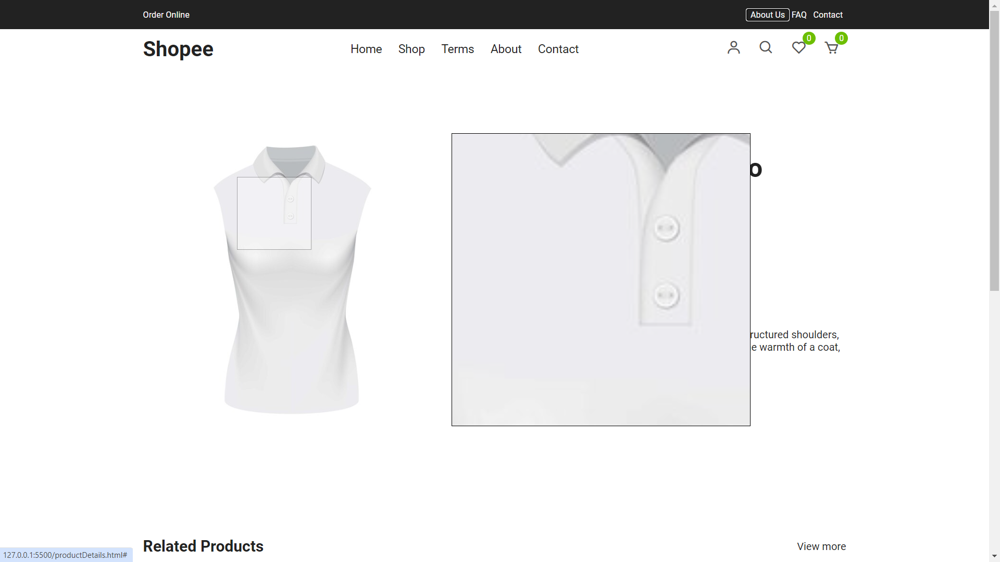
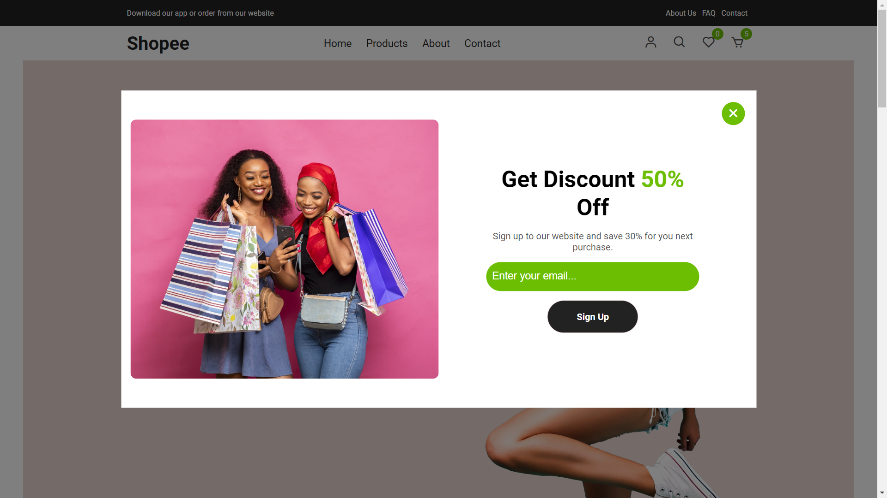
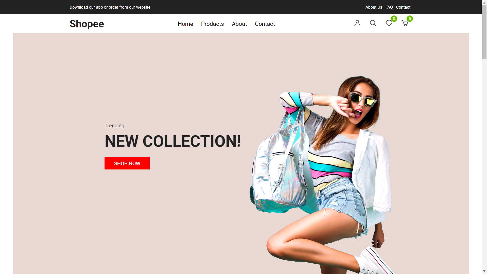
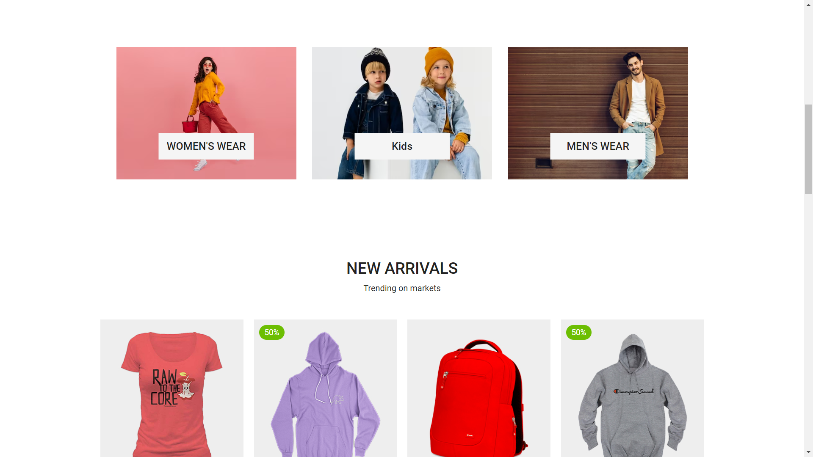
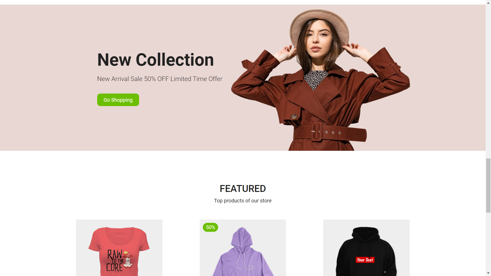
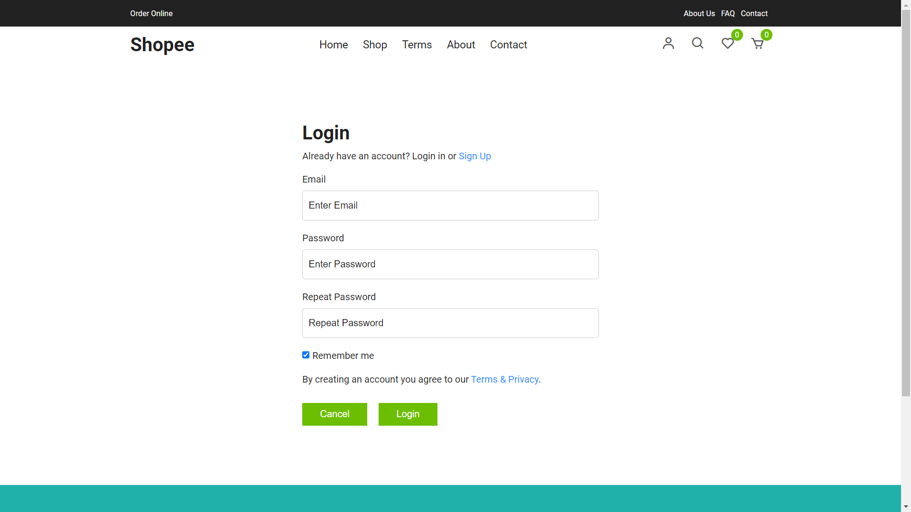
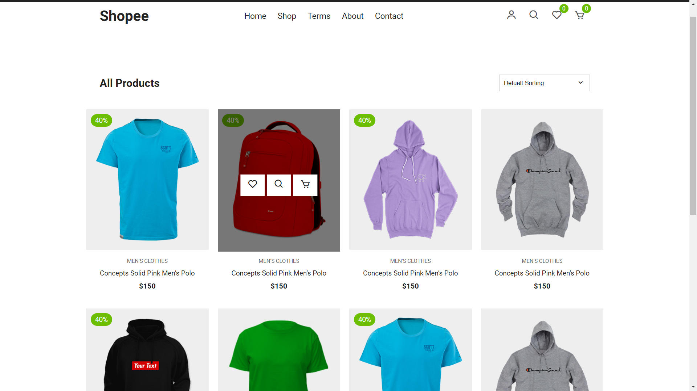
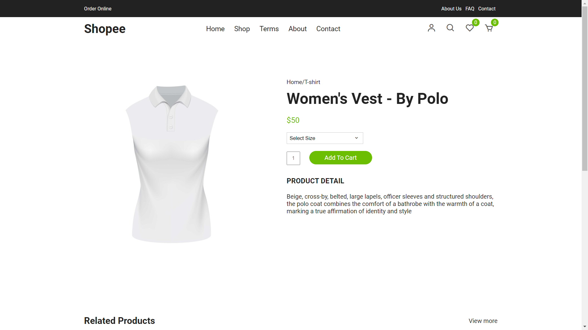

# Shopee Clothing Store

A multi-page clothing store front end.

## Features

- Image carousel (Glide.js)
- Categories and new-arrival sections
- Product page with sorting and pagination
- Product details with image zoom
- Cart, login and sign-up pages

## Run it

No build step. Open `index.html` in a browser, or serve the folder with any static server, for example `python -m http.server`.

## Screenshots

